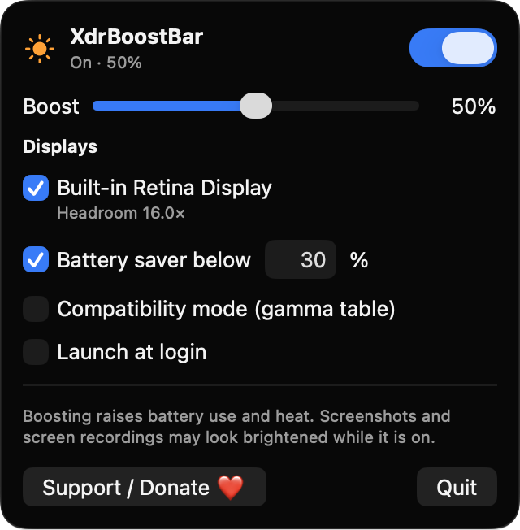
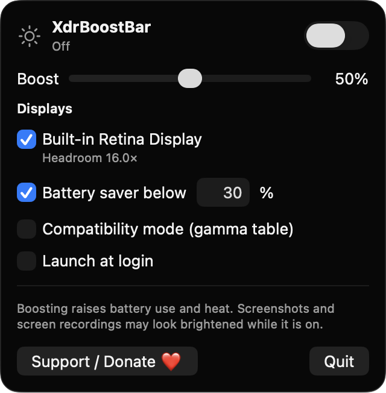

# XdrBoostBar

**🌐 Website:** [turhe123.github.io/xdr-boost-bar](https://turhe123.github.io/xdr-boost-bar/)

Unlock the extra HDR headroom of your MacBook Pro or XDR display for brighter everyday content with a slider.


## Why

XdrBoostBar is a free, open-source, 100% native, backend-free alternative to paid utilities in the *Display & Brightness* category. It was inspired by Vivid ($15 one-time), which showed there is real demand for using the extra brightness that mini-LED Mac displays can reach. The whole app is a handful of Swift files that use only Apple frameworks.

## Features

- **Menu bar app** with a sun icon (filled when the boost is active, outlined when off, dimmed when unsupported) and a popover UI.
- **Boost slider, 0–100%** that sets how much extra brightness is added on top of the system level. The multiplier is capped at 2× and never exceeds the display's reported EDR headroom.
- **Enabled switch** and a **global hotkey, Control + Option + B**, to toggle the boost from anywhere.
- **Automatic detection** of EDR-capable displays (`maximumPotentialExtendedDynamicRangeColorComponentValue > 1`). Each supported display is listed with its headroom, and you can enable the boost per display.
- **Three states:** Off, On with percentage, and Unsupported. When no EDR display is found, the popover says so and disables the controls.
- **Battery saver:** pauses the boost on battery below a threshold you choose (default 30%), and in Low Power Mode.
- **Thermal protection:** if the system thermal state reaches serious or critical, the boost ramps down smoothly over about a second and a notice is shown.
- **Compatibility mode (gamma table):** an alternative method that stretches the output curve with `CGSetDisplayTransferByFormula`, for cases where the overlay method does not brighten your screen.
- **Display changes handled:** overlays are rebuilt when displays are plugged or unplugged and after sleep or wake. Gamma tables are restored when the boost turns off and when the app quits.
- **Launch at login** via `SMAppService`.
- Settings are saved between launches.
- A **Support / Donate ❤️** button in the popover.

**How it works:** for each supported display, a click-through, borderless window at shielding level hosts a Metal view (float16, extended linear Display P3, EDR enabled). It renders a value above 1.0 and multiplies the desktop with it, which pushes pixels into the HDR headroom.

**Caveats:** boosting raises battery use and heat. Screenshots and screen recordings may look brightened while it is on. External non-HDR monitors are not supported. The result depends on compositing behavior, so it may vary across macOS versions and hardware.

## Screenshots

<p align="center"></p>

<p align="center"><em>The menu bar popover with the boost on at 50%, showing the detected EDR display and its 16× headroom, battery saver, and compatibility options.</em></p>

<p align="center"></p>

<p align="center"><em>With the boost off, the sun icon is outlined and the slider waits at your chosen level, ready to toggle with Control + Option + B.</em></p>

## Install

1. Download `XdrBoostBar-macOS.zip` from the [latest release](https://github.com/turhe123/xdr-boost-bar/releases/latest).
2. Unzip it and move `XdrBoostBar.app` to `/Applications`.
3. The app is open source and not notarized, so clear the quarantine flag:

   ```bash
   xattr -cr /Applications/XdrBoostBar.app
   ```

4. Right-click the app and choose **Open** the first time.

## Build from source

Requires macOS 14+ and Xcode with Swift 5.9+.

```bash
brew install xcodegen
xcodegen generate
xcodebuild -project XdrBoostBar.xcodeproj -scheme XdrBoostBar -configuration Release -derivedDataPath ./build build
```

The app is produced at `build/Build/Products/Release/XdrBoostBar.app`.

## Permissions

Based on the source, XdrBoostBar does not request any of the usual privacy permissions:

- **Accessibility:** not needed. The global hotkey uses Carbon `RegisterEventHotKey`, which works without it.
- **Screen Recording:** not needed. The app draws its own overlay and never captures screen content.
- **Microphone, Camera, Location, Contacts, etc.:** not used.
- **Network:** not used.

What it does use, without a permission prompt:

- Battery and power state (IOKit power sources, Low Power Mode, thermal state) for the battery saver and thermal protection.
- A login item, only if you turn on **Launch at login**. macOS may show it under System Settings → General → Login Items.

## Built with AI

XdrBoostBar was written by [Claude Code](https://claude.com/claude-code) inside an automated pipeline, from a plain-English spec. No code, binaries or assets from any commercial app were used; it is a clean-room reimplementation of a feature set, not a copy.

What that means in practice:

- The full source is in this repo under the MIT license. Read it before you run it.
- No network calls, no analytics, no third-party dependencies. Only Apple frameworks.
- Ad-hoc signed and not notarized, which is why Gatekeeper warns on first launch.
- It has had less human review than a hand-written app. Bug reports and pull requests are welcome.

## Support ❤️

If XdrBoostBar is useful to you, you can support its development:

[**Support Or (Leo) Davidai ❤️ on Ko-fi**](https://ko-fi.com/leodavidai)

## License

MIT © Or Davidai Bachar
